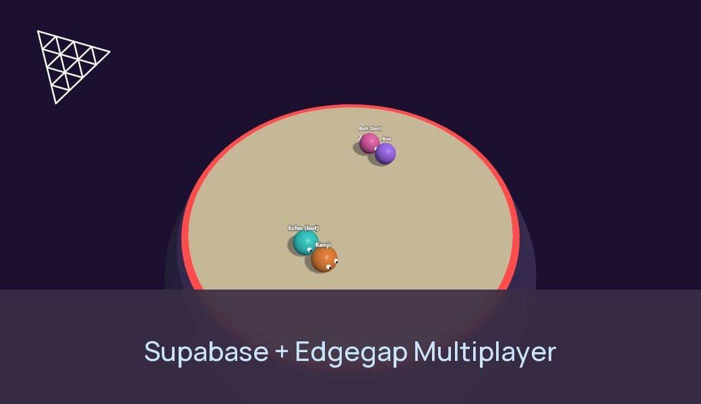
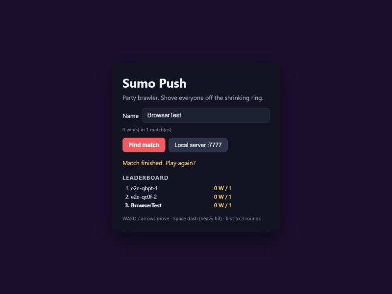
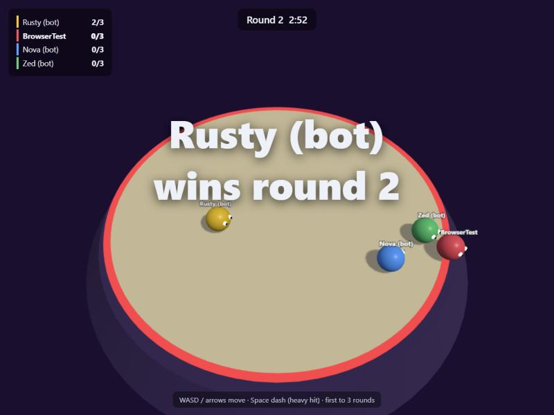

# Supabase + Edgegap: a multiplayer web game



A complete browser multiplayer game where **[Supabase](https://supabase.com) is the backend** (player accounts, profiles, a live leaderboard, match history, matchmaking gateway) and **[Edgegap](https://edgegap.com) runs the game servers** (one authoritative Node.js server per match, started near the players by the Edgegap matchmaker, stopped when the match ends).

The game is **Sumo Push** from [netcode-sample-threejs-minigames](https://github.com/edgegap/netcode-sample-threejs-minigames): a Three.js party brawler where up to 8 players shove each other off a shrinking ring. First to 3 rounds wins.

| Supabase does | Edgegap does |
|---|---|
| Signs players in (anonymous sign-in, upgradable to email or OAuth later) | Groups players with the matchmaker |
| Stores profiles, wins, match history (Postgres + Row Level Security) | Starts a dedicated server near them for each match |
| Keeps the matchmaker token secret in an Edge Function and ties every ticket to a user | Gives the page a `wss://` address with a valid certificate (TLS Upgrade) |
| Records results the game server reports, after checking each player's ticket | Bills the server only while the match runs; the server stops itself |
| Pushes leaderboard changes to every open page (Realtime) | |

<p>
  
  
</p>

**Verified end to end on 2026-11-03** with a hosted Supabase project (free plan, Supabase CLI 3.0.0) and the Edgegap free tier: two headless players signed in anonymously, queued through the Edge Function, landed on one Edgegap deployment in about 15 s, played a full match with their access tokens, the server recorded the match and both profiles in Supabase, and the deployment stopped itself 14 s after the match ([`tools/e2e.mjs`](tools/e2e.mjs)). A real browser did the same alone (matched after the 20 s expansion, with bots), and its menu leaderboard updated live when the match ended. Also checked against the live project: players can't change their wins, create tickets or call `record_match()`; a forged or missing token is refused by the game server; `report-match` refuses a wrong secret, a ticket that isn't the player's, and a replayed report; a human winner gets the win.

## How it fits together

```
 Browser (Three.js)                    Supabase                                   Edgegap
 ───────────────────                   ────────                                   ───────
 1. signInAnonymously() ─────────────▶ Auth: new user + profile row (trigger)
 2. Find match ──invoke("matchmaking")▶ Edge Function: check session,
                                        POST /groups ───────────────────────────▶ Matchmaker
                                        save ticket ⇄ user in public.tickets
 3. poll invoke("matchmaking") ────────▶ GET /groups/{id}/members/{id} ─────────▶ HOST_ASSIGNED: deploys a
    ◀── wss://<id>.pr.edgegap.net:<port>                                          server near the players
 4. wss connect, hello {ticket, access token} ══════════════════════════════════▶ Node.js game server
                                                                                   verifies the token (JWKS),
                                                                                   checks the ticket (MM_TICKET_IDS)
 5. play: inputs ⇄ snapshots ═══════════════════════════════════════════════════▶ authoritative simulation
 6.                                     Edge Function "report-match" ◀── POST result + shared secret
                                        record_match(): every ticket must belong
                                        to its user, unused → matches, wins
 7. leaderboard updates (Realtime) ◀── profiles changed                            server stops itself
```

Why this shape:
- **The browser never holds a secret.** It has the Supabase URL and publishable key (made to ship in clients, limited by Row Level Security). The Edgegap matchmaker token lives in Supabase secrets, so only signed-in players can queue.
- **The game server never holds a Supabase key.** It verifies players' access tokens against the project's public signing keys, and reports results through an Edge Function with a shared secret. A leaked secret still can't award wins: `record_match()` only accepts players with their own, unused matchmaker ticket.
- **The server decides the result.** Players send inputs; the server owns positions, rounds and the winner. Nothing a player changes in devtools reaches the leaderboard.
- **One deployment = one match.** Edgegap places it near the players and stops billing when it stops itself after the results screen.

## What's in the repo

| Path | What |
|---|---|
| `index.html`, `game/client.js`, `client/lib/` | The page: Three.js rendering, menu, HUD. `client/lib/backend.js` is all the Supabase client code (sign-in, profile, leaderboard, Find Match). |
| `client/config.js` | Supabase URL and publishable key (or `client/config.local.js`, git-ignored). |
| `server/` | Node.js game server: `room.js` (phases, bots, tick, snapshots), `supabase.js` (token check, result report), `edgegap.js` (matchmaker env, self-stop). |
| `game/server.js` | Sumo Push rules. |
| `supabase/migrations/` | Tables, Row Level Security, the new-user trigger, `record_match()`. |
| `supabase/functions/matchmaking/` | Edge Function between the page and the Edgegap matchmaker. |
| `supabase/functions/report-match/` | Edge Function the game server posts results to. |
| `supabase/config.toml` | Anonymous sign-ins on, JWT check done by the functions themselves. |
| `edgegap/matchmaker-config.json` | Matchmaker config to upload in the Edgegap dashboard. |
| `Dockerfile` | Game server image. |
| `tools/` | Static file server, local test, end-to-end test. |

## Quick start (local, no accounts)

Needs Node.js 22 or newer.

```bash
npm install
npm run dev
```

In a second terminal:

```bash
npm run web
```

Open http://localhost:8080, click **Local server**, then open a second tab to play against yourself. Bots fill empty seats. Without Supabase configured, the server lets anyone in and records nothing.

```bash
npm test
```

`npm test` plays a full match with two headless players and checks the phases and the result.

## Set up Supabase

You need a [Supabase account](https://supabase.com/dashboard) (the free plan is enough). The [Supabase CLI](https://supabase.com/docs/guides/local-development/cli/getting-started) runs through `npx`, nothing to install.

### 1. Create the project and push the schema

```bash
npx supabase login
npx supabase projects create edgegap-sumo --org-id <your-org-id> --region us-east-1
npx supabase link --project-ref <project-ref>
npx supabase db push --remote
npx supabase config push
```

`npx supabase orgs list` shows your org id; `projects create` prints the project ref (also in the dashboard URL). `db push` applies [`supabase/migrations/`](supabase/migrations): profiles, tickets, matches, Row Level Security and `record_match()`. `config push` turns on **anonymous sign-ins** from [`supabase/config.toml`](supabase/config.toml). It pushes every Auth setting in that file (it's the CLI's local-development defaults plus this sample's changes, e.g. email confirmations off), so on an existing project turn anonymous sign-ins on in the dashboard instead: Authentication → Sign In / Providers → Allow anonymous sign-ins.

The CLI asks for confirmation before changing a hosted project; add `--yes` in scripts.

### 2. Point the page at it

Copy `client/config.js` to `client/config.local.js` and fill in the **Project URL** and **Publishable key** from Project Settings → API Keys (`npx supabase projects api-keys --project-ref <ref>` prints them too):

```js
export default {
  supabaseUrl: "https://<project-ref>.supabase.co",
  supabasePublishableKey: "sb_publishable_...",
};
```

Reload http://localhost:8080: the menu now shows your generated name, your record and the leaderboard. Change the name and it's saved to your profile. **Find match** works once the matchmaker and the Edge Functions exist (steps 5 and 6).

You can also check the local server against Supabase without Edgegap: `SUPABASE_URL=https://<ref>.supabase.co npm run dev` refuses players who aren't signed in. Results are only recorded for matchmaker matches (they need a ticket).

## Host the game server on Edgegap

You need an [Edgegap account](https://app.edgegap.com) and Docker.

### 3. Push the image

```bash
docker login registry.edgegap.com
docker build --platform linux/amd64 -t registry.edgegap.com/<project>/sumo-supabase:<tag> .
docker push registry.edgegap.com/<project>/sumo-supabase:<tag>
```

Use your Container Registry credentials and project from the dashboard (**Container Registry**). Tag with the build time (`date -u +%Y%m%d-%H%M`), never `latest`.

### 4. Create the application and version

Dashboard → **Applications** → **Create application** (e.g. `sumo-supabase`), then a version named after the tag:

| Setting | Value |
|---|---|
| Image | `registry.edgegap.com` / `<project>/sumo-supabase` / `<tag>`, with your registry credentials |
| Port | `7777`, protocol **WS**, name `gameport`, **TLS Upgrade on** |
| vCPU / memory | 0.25 vCPU / 512 MB |
| Max duration | 30 minutes (a safety net: the server stops itself) |
| Environment variables | `SUPABASE_URL` = `https://<project-ref>.supabase.co` · `GAME_SERVER_SECRET` = a long random string (mark it secret) · `REQUIRE_TICKET` = `1` |

Edgegap shows env var values in the dashboard unless you hide them: tick **hidden** on `GAME_SERVER_SECRET`. Generate the secret with `node -e "console.log(require('crypto').randomBytes(32).toString('hex'))"` and keep it for step 6.

Optional timers: `WAIT_SECONDS` (15), `COUNTDOWN_SECONDS` (3), `RESULTS_SECONDS` (12), `MATCH_SECONDS` (180), `FIRST_JOIN_TIMEOUT_S` (120), `EMPTY_TIMEOUT_S` (30).

### 5. Create the matchmaker

Edit [`edgegap/matchmaker-config.json`](edgegap/matchmaker-config.json): set `application.name` and `application.version` to yours. Dashboard → **Matchmaker** → **Create matchmaker** → upload it → **Create and Start**. Copy the **API URL** and **Auth Token**.

The profile is free-for-all, 2 to 8 players, and lets a lone player in after 20 seconds (bots fill the ring). The browser never calls the matchmaker, so `allowed_cors_origins` doesn't need your page's origin.

### 6. Deploy the Edge Functions

```bash
npx supabase secrets set EDGEGAP_MM_URL=https://<id>.edgegap.net EDGEGAP_MM_TOKEN=<matchmaker auth token> GAME_SERVER_SECRET=<same secret as step 4>
npx supabase functions deploy matchmaking
npx supabase functions deploy report-match
```

`SUPABASE_URL` and `SUPABASE_SERVICE_ROLE_KEY` are provided to Edge Functions by Supabase. The functions check their callers themselves (`verify_jwt = false` in `config.toml`): `matchmaking` with `auth.getUser()`, `report-match` with the shared secret.

### 7. Play

Open http://localhost:8080 in two browser windows (two windows of the same profile share one Supabase session; use a private window or another browser for the second player) and click **Find match** in both within 20 seconds. Both land on the same Edgegap server. When the match ends, the leaderboard updates on both pages and the server stops itself.

Host the page anywhere static (GitHub Pages, Netlify, Vercel, Supabase Storage): it's plain files, no build step. Add the site's URL to Authentication → URL Configuration if you later add email or OAuth sign-in.

## The pieces in detail

### Signing players in

[`client/lib/backend.js`](client/lib/backend.js) calls `supabase.auth.signInAnonymously()` once; the session stays in `localStorage`, so the same player and their wins come back next visit. A trigger on `auth.users` creates the `profiles` row with a random name. To keep progress across devices, link an email or OAuth identity to the anonymous user later with `supabase.auth.updateUser({ email })` or `linkIdentity()`; the user id, and so the profile, stays the same.

### Find Match through an Edge Function

[`supabase/functions/matchmaking`](supabase/functions/matchmaking/index.ts) takes `{action: "join" | "status" | "cancel"}` with the player's session:

- `join`: cancels the player's previous search, `POST /groups {profile: "sumo", is_ready: true}` on the Edgegap matchmaker (a solo player is a group of one) and stores the membership with the user in `public.tickets`.
- `status`: `GET /groups/{group_id}/members/{member_id}`. The matchmaker fills in `ticket_id` only once the player is matched; the function saves it next to the user, and on `HOST_ASSIGNED` returns it with `wss://<fqdn>:<external port>`. An expired search returns `EXPIRED` and the page asks the player to try again.
- `cancel`: `DELETE /groups/{group_id}` (the player owns their group of one). Returns `CANCELLED`, or the current status when the matchmaker refuses because the match was already formed.

The page polls `status` every 1.5 s.

### Cancelling a search

A search left in the queue can still be matched and start a deployment nobody joins, so the page cancels it in every way it can leave:
- **Cancel** button: calls the function's `cancel`.
- **Closing or leaving the page** mid-search: `pagehide` sends `cancel` as a `fetch(..., {keepalive: true})`, which the browser completes after the page is gone (a normal `functions.invoke()` dies with the page).
- **Find match again**: `join` cancels the player's previous search first.

Verified on 2026-11-03: after a cancel, and after closing the page mid-search, the matchmaker reports the membership `CANCELLED` and never matches it.

What cancelling can't cover: a player whose match was already formed (`MATCH_FOUND`, server starting) when they left, or whose browser was killed without `pagehide`. The search then either expires (30 s, `ticket_expiration_period`) or gets a server; that server stops itself after `FIRST_JOIN_TIMEOUT_S` (120 s) if nobody joins, or plays on with the players who did come (with bots).

### The game server checks who joins

On `hello {name, ticket, token}` ([`server/room.js`](server/room.js)):
1. [`server/supabase.js`](server/supabase.js) verifies the access token's signature against `https://<ref>.supabase.co/auth/v1/.well-known/jwks.json` with [`jose`](https://github.com/panva/jose), and checks issuer and audience. The `sub` claim is the player's user id. No Supabase key and no call per player.
2. With `REQUIRE_TICKET=1`, the ticket must be in `MM_TICKET_IDS`, which Edgegap's matchmaker injects into the deployment.
3. One connection per user.

### Reporting results

When the match ends, the server posts every signed-in player's ticket, user id, score and place to [`report-match`](supabase/functions/report-match/index.ts) with `x-game-server-secret`. The function calls [`record_match()`](supabase/migrations/20261103000000_game_backend.sql), a `security definer` Postgres function only the service role may execute, which in one transaction:
- refuses any player whose ticket isn't theirs or was already used, and a winner who didn't play;
- inserts `matches` (unique per Edgegap deployment, so a retried report can't count twice) and `match_players`;
- marks the tickets used, adds a match to every player and a win to the winner (none on a draw or a bot win).

Players who leave before the end aren't reported.

### Live leaderboard

`profiles` is in the `supabase_realtime` publication. The page subscribes to `postgres_changes` on it and reloads the top 10 whenever a profile changes, so a match finishing anywhere updates every open menu.

### Who can do what (Row Level Security)

| Table | Players (publishable key + session) | Edge Functions (service role) |
|---|---|---|
| `profiles` | read all, update their own `display_name` only (column grant) | `record_match()` updates wins |
| `tickets` | read their own | create, update |
| `matches`, `match_players` | read all | `record_match()` inserts |

## Tests

```bash
npm test                                   # local server, two headless players, full match
SUPABASE_URL=https://<ref>.supabase.co SUPABASE_PUBLISHABLE_KEY=sb_publishable_... npm run e2e
```

`npm run e2e` (or `node tools/e2e.mjs <players>`, default 2) runs the whole stack like a browser does: anonymous sign-in and rename per player, Find Match through the Edge Function, all players on one Edgegap deployment, a full match with their access tokens, then it reads the recorded match, `match_players` and profiles back from Supabase, checks `report-match` refuses a wrong secret, and waits for the deployment to stop itself. Without the env vars it reads `client/config.local.js`.

Anonymous sign-ins are rate-limited per IP (30 per hour by default, `[auth.rate_limit] anonymous_users`).

## Troubleshooting

| Symptom | Fix |
|---|---|
| "Supabase sign-in failed: Anonymous sign-ins are disabled" | `npx supabase config push`, or turn them on in Authentication → Sign In / Providers. |
| Find Match: "Function exited due to an error" | A secret is missing: the function logs (dashboard → Edge Functions → matchmaking → Logs) say which. `npx supabase secrets set ...` (step 6); no redeploy needed. |
| Find Match: "Matchmaker: HTTP 401" | Wrong `EDGEGAP_MM_TOKEN`: use the matchmaker's Auth Token, not your Edgegap API token. |
| Stuck on "Searching for players..." then "No match found in time" | Matchmaker stopped, or its profile points at a version that doesn't exist. Check the matchmaker page in the dashboard. |
| "Not signed in: ..." when connecting | The server's `SUPABASE_URL` doesn't match the page's project, or the token expired mid-session (reload the page). |
| "Unknown matchmaker ticket" | `REQUIRE_TICKET=1` and the player joined without a ticket (e.g. `?server=` direct mode). |
| Match played but leaderboard unchanged | Read the deployment logs (`supabase: report-match HTTP ...`). 403 = `GAME_SERVER_SECRET` differs between Edgegap and Supabase; 422 = a ticket was refused. |
| `wss://` fails, or connects only after a few seconds | TLS Upgrade must be on for `gameport`. A fresh deployment refuses connections for a few seconds; the client retries. |

## Going to production

- Matchmaker: `inspect: false`, and raise `ticket_expiration_period` if queues get longer (an abandoned search lives that long if its cancel never arrives).
- Abandoned matches: lower `FIRST_JOIN_TIMEOUT_S` (e.g. 60) so a server whose players all left before joining stops sooner, and watch for deployments that end with `self-stop: nobody joined` in your logs.
- Let players keep their account: link email or OAuth to the anonymous user.
- Clean up old rows in `tickets` (e.g. a `pg_cron` job deleting unused tickets older than a day).
- Ship server updates by pushing a new tag and pointing the app version at it, or with the [Edgegap deploy GitHub Action](https://github.com/edgegap/deploy-action).

## Using a coding agent

The `edgegap-supabase` skill in [Edgegap's agent skills](https://github.com/edgegap/llm-agent-skills) ships this sample's schema, Edge Functions, server and client changes as templates, and walks an agent through the same steps for your own game. The [Edgegap MCP server](https://github.com/edgegap/llm-mcp-server) (0.15.8 and later) serves it too.

## Links

- Edgegap docs: [matchmaking](https://docs.edgegap.com/learn/matchmaking), [deployments](https://docs.edgegap.com/learn/orchestration/deployments)
- Supabase docs: [anonymous sign-ins](https://supabase.com/docs/guides/auth/auth-anonymous), [Edge Functions](https://supabase.com/docs/guides/functions), [Row Level Security](https://supabase.com/docs/guides/database/postgres/row-level-security), [Realtime](https://supabase.com/docs/guides/realtime/postgres-changes), [JWT signing keys](https://supabase.com/docs/guides/auth/signing-keys)
- Original game: [netcode-sample-threejs-minigames](https://github.com/edgegap/netcode-sample-threejs-minigames)

## License

MIT, see [LICENSE](LICENSE).
